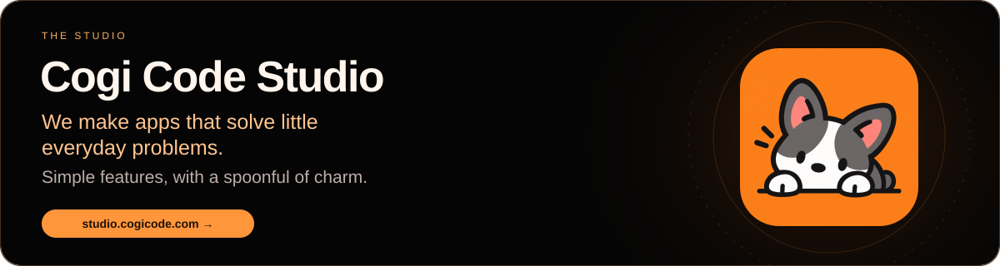

  

  

  작은 불편함을 해결하고 감성을 더해 개발해요. 
  <b>React . React Native . TS</b>

  
  

 

  

  작은 불편함을 덜어주는 앱을 만들어요. 
  단순한 기능과 감성을 한 스푼 더해요.

 

<h3 align="center">🛠 Things I build with</h3>

  

  
  
  

 

<h3 align="center">⚡ The building continues</h3>

  

  Little solutions. A little charm.

<!-- Widgets: DenverCoder1/readme-typing-svg · tandpfun/skill-icons · badges/shields · Ashutosh00710/github-readme-activity-graph -->
